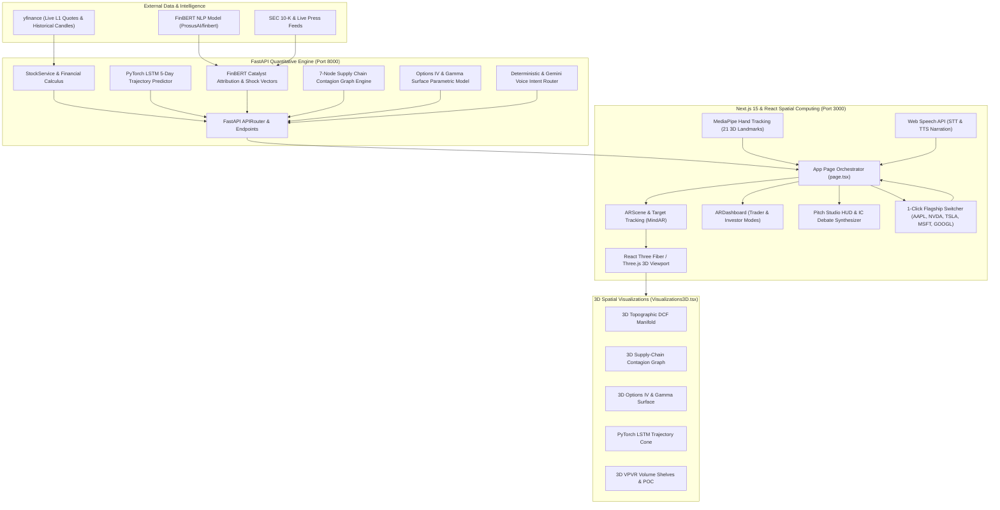

# AlphaLens: The Spatial Catalyst, Valuation & Contagion Stress-Testing Terminal

[](https://nextjs.org/)
[](https://fastapi.tiangolo.com/)
[](https://threejs.org/)
[](https://pytorch.org/)
[](https://huggingface.co/ProsusAI/finbert)
[](https://hiukim.github.io/mind-ar-js-doc/)

**AlphaLens** is a spatial computing financial intelligence terminal designed for hedge funds, equity research analysts, and investment committees. It bridges institutional-grade quantitative finance with browser-based augmented reality (**WebAR**), interactive 3D sensitivity manifolds, and neural NLP attribution.

By pointing a webcam at a physical company logo or selecting one of the 5 flagship tickers (`AAPL`, `NVDA`, `TSLA`, `MSFT`, `GOOGL`), AlphaLens projects an interactive spatial workspace directly onto the analyst's desk. Analysts can physically manipulate 3D DCF elevation manifolds, simulate 2nd-order supply-chain shocks across global silicon foundries, inspect institutional volume shelves (VPVR), traverse options implied volatility (IV) smiles, and conduct autonomous Investment Committee (IC) thesis debates using optical hand gestures and voice commands.

---

## System Architecture



---

## Core Spatial Modules & Mathematical Formulations

### Module 1: FinBERT Catalyst Attribution & Scenario Shock Engine
The NLP pipeline utilizes `ProsusAI/finbert` fine-tuned on financial sentiment to parse company-specific press releases, SEC filings, and news feeds. It classifies headlines into discrete sentiment polarities ($p_i \in [-1, 1]$) with model confidence ($c_i \in [0, 1]$) and maps them into quantitative shock vectors:

$$\vec{S}_{\text{catalyst}} = \begin{bmatrix} \Delta \text{WACC} \\ \Delta g \\ \Delta \text{Operating Margin} \\ \Delta \text{Price Drift} \end{bmatrix} = \sum_{i=1}^M c_i \cdot p_i \cdot \vec{\omega}_i$$

* **Bear Stress Shock:** $\Delta \text{WACC} = +1.50\%$, $\Delta g = -1.00\%$, $\Delta \text{Margin} = -2.00\%$
* **Bull Expansion Shock:** $\Delta \text{WACC} = -1.00\%$, $\Delta g = +1.50\%$, $\Delta \text{Margin} = +2.00\%$
* **Base Case:** Calibrated to trailing consensus fundamental projections.

Analysts can apply individual catalyst shock vectors directly from the UI or dynamically adjust parameters via slider controls and voice prompts.

---

### Module 2: 3D Topographic DCF Sensitivity Manifold
Traditional financial analysis displays sensitivity tables as flat 2D spreadsheets. AlphaLens elevates this into a 3D continuous topological surface $Y(w, g)$ where the Z-axis represents Terminal Growth Rate ($g$) and the X-axis represents the Weighted Average Cost of Capital ($\text{WACC}$).

$$\text{Enterprise Value} = \sum_{t=1}^{5} \frac{\text{FCF}_0 \cdot (1 + \text{CAGR} + \Delta \text{Margin})^t}{(1 + \text{WACC} + \Delta \text{WACC})^t} + \frac{\text{FCF}_5 \cdot (1 + g + \Delta g)}{(\text{WACC} + \Delta \text{WACC} - g - \Delta g)(1 + \text{WACC} + \Delta \text{WACC})^5}$$

$$\text{Implied Fair Value per Share} = \frac{\text{Enterprise Value} + \text{Cash} - \text{Total Debt}}{\text{Diluted Shares Outstanding}}$$

$$\text{Margin of Safety (\%)} = \frac{\text{Implied Fair Value} - P_{\text{spot}}}{P_{\text{spot}}} \times 100\%$$

* **Spatial Mesh:** $5 \times 5$ vertex grid with bicubic vertex interpolation.
* **Elevation & Color Map:** 
  * Vertices where $\text{Fair Value} > P_{\text{spot}}$ elevate upward with emerald-green luminescence.
  * Vertices where $\text{Fair Value} < P_{\text{spot}}$ depress downward into crimson valleys.
* **Spot Price Waterline:** A semi-transparent cyan reference plane intersects the terrain at exactly $Y = P_{\text{spot}}$, visually demarcating the threshold between under- and over-valuation.

---

### Module 3: 3D Supply-Chain & Ecosystem Contagion Graph
Modern mega-cap equities do not operate in isolation. AlphaLens renders a 7-node spatial network organized across a 3-hemisphere topology:

* **Left Hemisphere ($X < 0$):** Upstream suppliers, semiconductor foundries, and contract manufacturers (e.g., `TSMC`, `Foxconn`, `Qualcomm`, `SK Hynix`).
* **Center Origin ($X = 0, Y = 0, Z = 0$):** The focal equity (`AAPL`, `NVDA`, `TSLA`, `MSFT`, `GOOGL`) enclosed in an animated dual-ring energy core.
* **Right Hemisphere ($X > 0$):** Downstream revenue channels, cloud hyperscalers, and regulatory jurisdictions (e.g., `Google TAC`, `US DoJ / EU DMA`, `OpenAI / Azure`, `Supermicro / Dell`).

#### 2nd-Order Contagion Shock Propagation
When an analyst stress-tests an upstream or downstream node, shocks cascade through the network to revalue the focal asset:

$$\Delta \text{Margin}_{\text{focal}} = \sum_{i \in \text{Upstream}} \text{Shock}_i \cdot w_i \cdot \beta_{\text{margin}}$$

$$\Delta \text{Revenue}_{\text{focal}} = \sum_{j \in \text{Downstream}} \text{Shock}_j \cdot w_j \cdot \beta_{\text{revenue}}$$

$$\Delta \text{Fair Value} = \frac{\partial \text{DCF}}{\partial \text{Margin}} \cdot \Delta \text{Margin}_{\text{focal}} + \frac{\partial \text{DCF}}{\partial \text{Revenue}} \cdot \Delta \text{Revenue}_{\text{focal}}$$

* **Quadratic Bezier Curves:** Dynamic particle streams flow along 3D curves $\mathbf{B}(t) = (1-t)^2 \mathbf{P}_0 + 2(1-t)t \mathbf{P}_1 + t^2 \mathbf{P}_2$.
* Upstream edges transmit material/wafer supply flows; downstream edges transmit cash/royalty flows. Under stress, edge colors transition to warning amber/crimson with accelerated pulse velocity.

---

### Module 4: 3D Options Implied Volatility (IV) & Gamma Surface
For derivatives desks and cross-asset traders, AlphaLens computes and visualizes the options volatility smile across moneyness and term structure:

$$\sigma_{\text{IV}}(m, \tau) = \sigma_0(\tau) + \alpha \cdot (1 - m) + \beta \cdot (1 - m)^2 + \gamma \cdot \frac{1}{\sqrt{\tau}}$$

Where:
* $m = \frac{K}{S}$ is standard moneyness ($m \in [0.70, 1.30]$).
* $\tau = \frac{\text{DTE}}{365}$ is annualized time to expiry ($\tau \in [7\text{d}, 365\text{d}]$).
* $\alpha > 0$ governs the put-skew asymmetry for institutional downside crash protection.
* $\beta > 0$ governs the smile convexity.
* $\gamma$ parameterizes the short-dated volatility term premium.

The surface is rendered as an illuminated 3D wireframe mesh with isolines connecting constant-delta and constant-maturity tranches.

---

### Module 5: PyTorch LSTM Trajectory Cone & Institutional VPVR Shelves
* **Multi-Horizon LSTM:** A 2-layer sequence-to-sequence PyTorch LSTM trained on multi-feature price action (OHLCV, RSI, MACD, Parkinson Volatility) projects a 5-day neural price drift $\hat{P}_{t+k}$ with expanding $90\%$ and $95\%$ Gaussian confidence bounds:
  $$\text{Cone}_{t+k} = \hat{P}_{t+k} \pm z_{\alpha/2} \cdot \hat{\sigma}_{\text{Parkinson}} \sqrt{k}$$
* **3D Volume Profile Visible Range (VPVR):** Aggregates tick and minute volume into $N = 40$ discrete price bins across the trading horizon.
  * **Point of Control (POC):** Extruded horizontally as a prominent amber institutional volume shelf:
    $$\text{POC} = \arg\max_{P_k} V(P_k)$$
  * **Value Area (VAH / VAL):** Encapsulates the $70\%$ volume distribution interval $[P_{\text{VAL}}, P_{\text{VAH}}]$.

---

### Module 6: Pitch & Broadcast Studio
Built for senior analysts delivering live executive briefings:
* **5-Stage Autonomous Cinematic Tour:**
  1. *Executive Identity & Spot Valuation*
  2. *Market Microstructure & VPVR Volume Shelves*
  3. *3D Topographic DCF Stress Surface*
  4. *FinBERT Catalyst Attribution & Shock Vectors*
  5. *3D Global Supply-Chain Contagion Graph*
* **Investment Committee (IC) Bull vs. Bear Debate:** An interactive debate synthesizer pits an aggressive Growth Bull thesis against a prudent Value Bear critique, producing a synthesized CIO Overweight/Underweight verdict and structure narrated in real-time via the browser's speech synthesis engine.
* **MediaPipe Optical Gesture Control:** Tracks 21 3D hand landmarks in real-time through the webcam:
  * *Swipe Left / Right:* Cycles between Trader (Technicals) and Investor (Valuation) workspaces.
  * *Pinch & Drag:* Smoothly adjusts camera angle and elevation.
* **Deterministic & LLM Voice Navigation:** Parses natural voice queries (e.g., *"Stress test bear case"*, *"Show contagion graph"*, *"What is the DCF fair value?"*) using deterministic regex routing with Gemini fallback.

---

## Flagship Tickers Matrix

| Ticker | Company | Key Upstream Nodes | Key Downstream / Ecosystem Nodes | Flagship FinBERT Catalysts |
| :--- | :--- | :--- | :--- | :--- |
| **`AAPL`** | Apple Inc. | TSMC (3nm), Foxconn, Qualcomm, Sony | Google ($20B TAC), App Store Regulators, EU DMA | AI Siri rollout, Gross margin expansion, TAC antitrust |
| **`NVDA`** | NVIDIA Corp. | TSMC (CoWoS), SK Hynix (HBM3e), Micron | Microsoft Azure, AWS, Google Cloud, Meta | Blackwell server racks, Rubin architecture, China restrictions |
| **`TSLA`** | Tesla, Inc. | CATL, Panasonic, LG Energy, NVIDIA | Supercharger Network, Robotaxi Fleet, FSD Regulatory | Cybercab unveil, 4680 cell ramp, Auto gross margin ex-credits |
| **`MSFT`** | Microsoft Corp. | NVIDIA (Hopper/Blackwell), AMD, Intel | Enterprise Office 365, Copilot Enterprise, Azure Cloud | Copilot monetization, Azure AI growth, OpenAI alliance |
| **`GOOGL`** | Alphabet Inc. | Broadcom (TPU), TSMC, Samsung | Apple Safari TAC, YouTube Ads, Google Cloud | Gemini Ultra rollout, Search ad antitrust, Cloud profitability |

---

## Quick-Start & Local Deployment

### 1. Prerequisites
* **Node.js** (v18.0 or higher)
* **Python** (v3.10 or higher)
* **Webcam** (built-in or USB webcam for AR tracking & hand gestures)

### 2. Backend Setup (FastAPI)
1. Open a terminal and navigate to `backend/`:
   ```bash
   cd backend
   ```
2. Create and activate a Python virtual environment:
   ```bash
   # Windows (PowerShell)
   python -m venv venv
   .\venv\Scripts\Activate.ps1

   # macOS / Linux
   python3 -m venv venv
   source venv/bin/activate
   ```
3. Install required Python packages:
   ```bash
   pip install -r requirements.txt
   ```
4. Start the FastAPI development server:
   ```bash
   python -m uvicorn main:app --reload --host 0.0.0.0 --port 8000
   ```
   *The quantitative API will be live at `http://localhost:8000` (Swagger docs at `/docs`).*

### 3. Frontend Setup (Next.js 15)
1. Open a second terminal and navigate to `frontend/`:
   ```bash
   cd frontend
   ```
2. Install npm dependencies:
   ```bash
   npm install
   ```
3. Launch the Next.js development server:
   ```bash
   npm run dev
   ```
4. Open `http://localhost:3000` in Google Chrome or Microsoft Edge.

---

## Operating AlphaLens

1. **Camera Permissions:** Grant browser camera access when prompted.
2. **Instant 1-Click Launch:** You do not need physical AR cards to begin. Click any of the 5 flagship ticker buttons (`AAPL`, `NVDA`, `TSLA`, `MSFT`, `GOOGL`) at the top of the screen to launch that company's spatial model immediately.
3. **Physical AR Target Tracking:** Alternatively, point your camera at a printed company logo (Apple, Tesla, etc.) to project the 3D model directly onto the marker via MindAR.
4. **1-Click Ticker Switching:** Switch between companies instantly using the pill bar in the ARDashboard header or within the **🎬 Pitch Mode** HUD.
5. **Interactive Controls:**
   * Click **Valuation & Thesis** to inspect the 3D DCF Sensitivity Manifold.
   * Click **Contagion Graph** to simulate 2nd-order supply chain disruptions.
   * Click **Timing & Technicals** to inspect the 3D VPVR volume shelves and options IV smile.
   * Click **🎬 Pitch Mode** to activate the autonomous 5-stage camera tour or trigger the **Bull vs. Bear IC Debate**.
   * Toggle **✋ Gestures On** to control the terminal via optical hand gestures.
   * Click the microphone or use voice shortcuts (*"stress test bear"*, *"show dcf"*, *"show peers"*, *"switch to trader"*).

---

## License & Attribution
AlphaLens is built with Next.js, Three.js, React Three Fiber, MindAR, MediaPipe, FastAPI, PyTorch, and HuggingFace FinBERT. Released under the MIT License.
